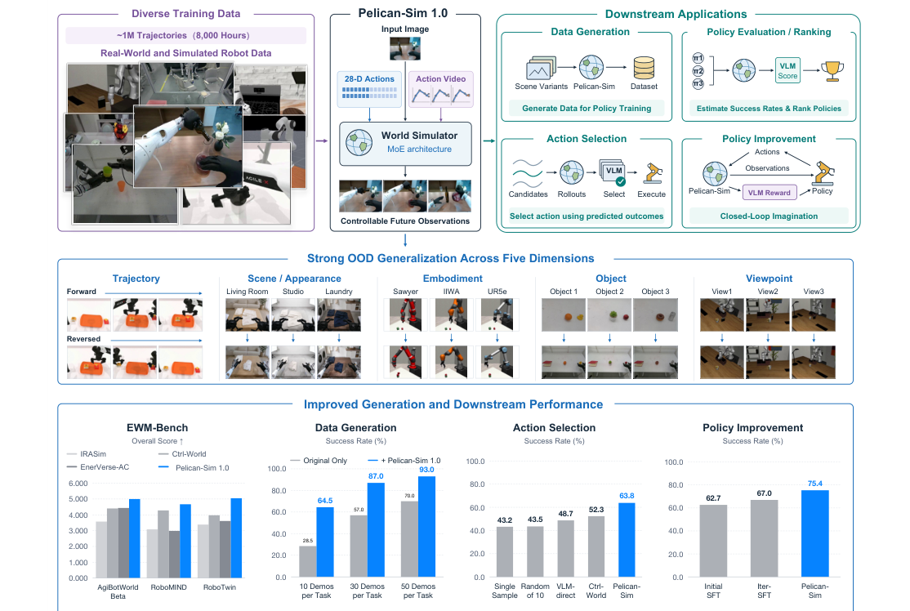
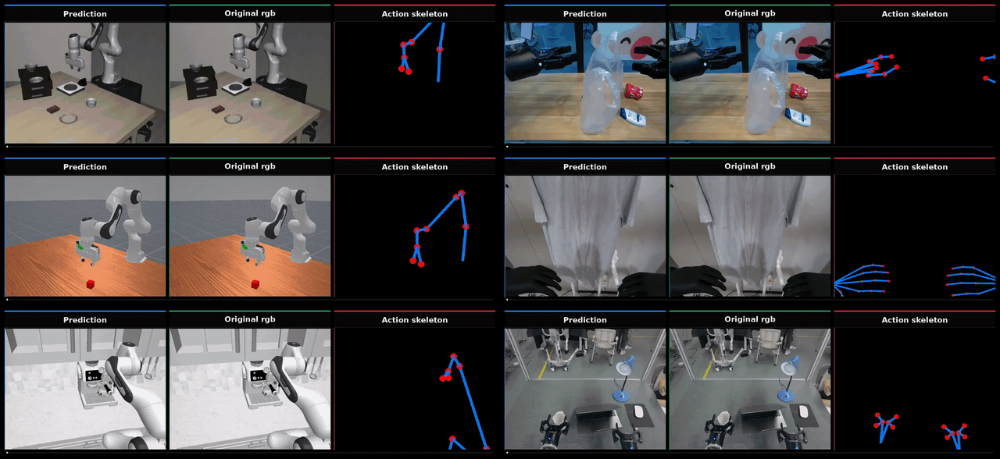
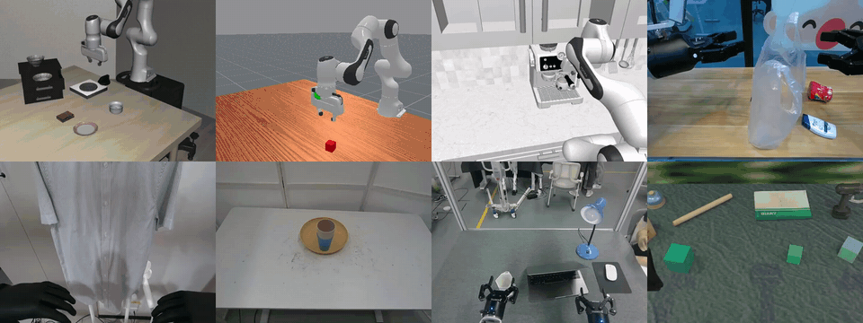
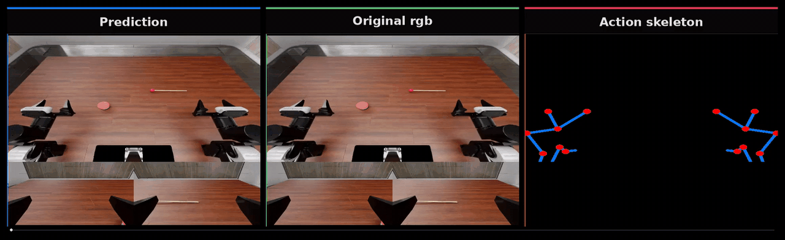

<p align="center">
  <h1 align="center">Pelican-Sim 1.0</h1>
  <p align="center"><b>A General World Model Simulator for Embodied Intelligence</b></p>
  <p align="center">
    WFM System Group<br>
    Beijing Innovation Center of Humanoid Robotics (X-Humanoid)
  </p>
  <p align="center">
    <code>{jack.zou,vito.dai,jian.tang,jason.ju}@x-humanoid.com</code>
  </p>
  <p align="center">
    <a href="https://zoushilong1024.github.io/Pelican-Sim1.0/"></a>
    <a href="https://arxiv.org/abs/2609.12036"></a>
    <a href="https://huggingface.co/ShilongZou/Pelican-Sim1.0"></a>
    <a href="https://github.com/ZouShilong1024/Pelican-Sim1.0"></a>
  </p>
</p>

<p align="center">
  
</p>
<p align="center">
  <em>One model maps an RGB frame, unified 28-D actions, and a camera-aligned action video to future observations, then supports data generation, policy evaluation, action selection, and policy improvement.</em>
</p>

**Pelican-Sim 1.0 is a shared action-conditioned world model simulator for heterogeneous robots.** Given a
first-frame RGB image, a robot joint trajectory, and a language instruction, it predicts the future video. The
trajectory enters the model twice — as numerical configurations and as a URDF-rendered, camera-aligned skeleton
video — and the two conditions are injected into alternating blocks of a sparse-MoE Video DiT.

This repository holds inference and fine-tuning code for the released checkpoint, eight example episodes, and an
online skeleton renderer. The fine-tuning guide uses
[RoboDojo](docs/finetune_robodojo.md) as its worked example.

> **Abstract.** Robot world models must predict not merely plausible videos, but outcomes faithful to specified
> actions. Across heterogeneous robots, numerical configurations preserve joint-level detail but leave visual
> consequences implicit, whereas projected visual actions expose motion geometry but obscure depth and configuration
> information. Our key idea is to let these complementary representations interact throughout generation. We
> introduce Pelican-Sim 1.0, a shared action-conditioned world model simulator that injects numerical configurations
> and camera-aligned whole-arm skeleton videos into alternating video-transformer blocks. Each condition shapes hidden
> states already informed by the other, coupling configuration detail with projected geometry. Sparse
> mixture-of-experts layers accommodate heterogeneous dynamics, while causal adaptation and few-step distillation
> support efficient autoregressive rollouts. Trained on approximately one million real and simulated trajectories,
> Pelican-Sim 1.0 outperforms all evaluated baselines on five video-quality metrics across held-out splits of
> AgiBotWorld Beta, RoboMIND, and RoboTwin. On RoboTwin, generated-data augmentation raises policy success from
> 70.0% to 93.0%, while imagined policy optimization with task-specific simulator adaptation improves success from
> 62.7% to 75.4%.

### Highlights

- **A unified cross-embodiment world model simulator.** One checkpoint covers parallel-gripper, dexterous-hand,
  single-arm, and bimanual robots through a canonical 28-D action layout, and generates interactive videos that
  follow the commanded actions. Its distilled four-step autoregressive variant enables efficient rollouts, and a
  fine-tuned VLM evaluator turns predicted outcomes into feedback for policy evaluation, action selection, and policy
  optimization.
- **Action alignment and sparse expert capacity both help with heterogeneous dynamics.** Interleaving numerical and
  visual conditions through shared hidden states beats single-condition, concatenation, and late-fusion baselines
  (PSNR **+0.904 dB** over late fusion on AgiBotWorld Beta). With the action interface and the mixed real–simulated
  corpus fixed, sparse MoE (1 shared + 8 routed experts, top-2) further lowers FVD by **6.530** over the dense
  backbone. Both are general mechanisms for modeling video dynamics.
- **State-of-the-art prediction and downstream utility.** Pelican-Sim 1.0 leads all evaluated baselines on five
  video-quality metrics across three held-out test sets (PSNR **+4.636 / +2.080 / +10.343 dB** on AgiBotWorld Beta /
  RoboMIND / RoboTwin) and supports four downstream policy applications. On RoboTwin, data augmentation and imagined
  policy optimization raise policy success from **70.0% → 93.0%** and **62.7% → 75.4%**. Qualitative studies show
  action-consistent predictions under trajectory, scene, embodiment, object, and viewpoint shifts.
- **Open release.** Model weights on Hugging Face; inference and fine-tuning code and example data in this
  repository.

<p align="center">
  <a href="assets/results.mp4"></a>
</p>
<p align="center">
  <em>Bundled rollouts (left → right): prediction · original RGB · action skeleton.</em>
</p>

## News

- **2026-11-07** — [Multi-view RoboDojo](#multi-view-robodojo) fine-tuning and inference: the head camera and both
  wrist cameras on one canvas, rolled out chunk by chunk to the end of the episode (`infer_robodojo_mv.sh`).
- **2026-11-05** — Fine-tuning code and a [RoboDojo fine-tuning guide](docs/finetune_robodojo.md).
- **2026-11-05** — Released the Pelican-Sim 1.0 checkpoint on [Hugging Face](https://huggingface.co/ShilongZou/Pelican-Sim1.0).
- **2026-11-04** — Inference code, eight example episodes, and the online action-video renderer released.
- **2026-09-10** — Paper on [arXiv](https://arxiv.org/abs/2609.12036).

## 🤗 Model Zoo

| Checkpoint | Architecture | Sampler | Use it for |
| --- | --- | --- | --- |
| [`ShilongZou/Pelican-Sim1.0`](https://huggingface.co/ShilongZou/Pelican-Sim1.0) | 2B Cosmos-Predict2.5 Video DiT + sparse MoE (1 shared + 8 routed experts, top-2) + dual action conditioning | 35-step bidirectional rectified flow, 93 frames at 480×640 | Inference, and **the starting point for fine-tuning on your own robot / task** |

The checkpoint is a single file, `model_ema_bf16.pt` (EMA weights, bf16, ~23.6 GB), and holds every trained
weight. The frozen public components are downloaded automatically from their own releases on first use: the
Wan2.1 VAE tokenizer from [`nvidia/Cosmos-Predict2.5-2B`](https://huggingface.co/nvidia/Cosmos-Predict2.5-2B) and
the text encoder [`nvidia/Cosmos-Reason1-7B`](https://huggingface.co/nvidia/Cosmos-Reason1-7B). Accept their
licenses on Hugging Face before the first run.

## Installation

**Requirements.** Linux x86-64 (glibc ≥ 2.35, e.g. Ubuntu ≥ 22.04), an NVIDIA GPU of Ampere or newer with at
least 64 GB of memory (single-GPU inference peaks at about 59 GB), an NVIDIA driver compatible with CUDA 12.8, and `ffmpeg`.

```bash
git clone https://github.com/ZouShilong1024/Pelican-Sim1.0.git
cd Pelican-Sim1.0

# uv-managed Python 3.10 environment (CUDA 12.8 / PyTorch 2.7)
curl -LsSf https://astral.sh/uv/install.sh | sh
uv python install 3.10
uv sync --extra=cu128          # Blackwell (B200 / GB200) or CUDA 13: --extra=cu130
uv pip install yourdfpy opencv-python pyarrow   # online skeleton rendering
source .venv/bin/activate
```

### Download the weights

```bash
hf auth login                  # token that has accepted the NVIDIA Cosmos licenses
hf download ShilongZou/Pelican-Sim1.0 --local-dir checkpoints/Pelican-Sim-1.0
```

`infer.sh` picks up `checkpoints/Pelican-Sim-1.0/model_ema_bf16.pt` automatically. To keep the checkpoint
elsewhere, set `CKPT_PATH=/path/to/model_ema_bf16.pt`. Set `HF_HOME` if the default Hugging Face cache
(`~/.cache/huggingface`) is short on space. Machine-specific settings (proxy, `HF_HOME`, …) can go into an
untracked `.env.local`, which `infer.sh` sources if present.

## Quick start

```bash
# One example, single 93-frame chunk
SAMPLE_DIR=examples/samples/libero_spatial_top_drawer NPROC=1 MODE=single ./infer.sh

# One example, autoregressive until the episode ends
SAMPLE_DIR=examples/samples/agibot_put_in_bag ./infer.sh

# All eight examples
./infer.sh

# Multi-GPU: one example per GPU
NPROC=8 CUDA_VISIBLE_DEVICES=0,1,2,3,4,5,6,7 ./infer.sh
```

Outputs land under `outputs/` (or `$OUT_DIR`):

| File | Content |
| --- | --- |
| `<name>.mp4` | predicted video |
| `<name>_original_rgb.mp4` | original RGB (`rgb.mp4`, temporally aligned) |
| `<name>_action_video.mp4` | online-rendered skeleton |
| `<name>_comparison.mp4` | **Prediction \| Original RGB \| Action skeleton** |

Defaults: autoregressive over the whole episode, 35 flow steps, guidance 3, 480×640, saved at 15 fps. Useful
overrides: `MODE=single` (one 93-frame chunk), `NUM_STEPS`, `GUIDANCE`, `SEED`, `CHUNK_SIZE` (93),
`MATCH_EPISODE_LENGTH=0` with `NUM_OUTPUT_FRAMES`, `OUT_DIR`.

## Reproduce the paper examples

Eight self-contained clips live under [`examples/samples/`](examples/samples/) (listed in
`examples/samples/manifest.txt`), one dataset and one episode per folder. Inference always conditions on
`first_frame.png`; `rgb.mp4` only fills the middle panel of the comparison video. `robodojo_mv_hold_button` next
to them needs the multi-view checkpoint (see [Multi-view RoboDojo](#multi-view-robodojo)).

<p align="center">
  <a href="assets/examples.mp4"></a>
</p>
<p align="center">
  <em>Libero · ManiSkill · RoboCasa · AgiBot &nbsp;|&nbsp; AgiBot dexhand · RealSource · RoboMind · RoboTwin</em>
</p>

## Use your own data

Copy any example folder and replace the payload files, keeping the same names.

```text
examples/samples/my_task/
  first_frame.png    # required — RGB condition (first frame only)
  rgb.mp4            # optional — original RGB for the comparison middle panel
  action.npy         # required — [T, 8] (Panda) or [T, 28] (unified bimanual)
  prompt.txt         # required — English instruction
  meta.json          # required — source and camera for the online skeleton
```

### 1. Action

- Franka / Panda simulation (`libero`, `maniskill`, `robocasa`): native `[T, 8]`, `"already_unified": false`.
  The gripper is the aperture in meters.
- Bimanual / real robots: unified `[T, 28]`, `"already_unified": true`:

```text
left_arm(7) + left_gripper(1) + left_dexhand(6)
+ right_arm(7) + right_gripper(1) + right_dexhand(6)
```

Arm joints are in radians and the gripper in `[0, 1]`. Missing dexterous hands are zeros. Single-arm robots fill
the **left** side only.

### 2. `meta.json`

```json
{
  "source": "agibot",
  "name": "my_task",
  "prompt": "put the can in the bag",
  "frames": 1005,
  "action_dim": 28,
  "already_unified": true,
  "width": 640,
  "height": 480,
  "rgb": "first_frame.png",
  "rgb_video": "rgb.mp4",
  "action": "action.npy"
}
```

`source` selects the online skeleton renderer. Copy the closest example and keep its camera fields.

| `source` | Camera fields in `meta.json` |
| --- | --- |
| `libero` / `maniskill` | `K`, `base_pos` (+ `E_cam2world` or `E_world2cam`) |
| `robocasa` | same as above + `base_quat_wxyz` |
| `robotwin` | `K`, `E_world2cam` |
| `robomind` | `robot`, `org_path` |
| `real_source_world` | `camera_entry` |
| `agibot` | `camera_params` `{fx,fy,cx,cy,camera_offset_xyz}`, `head_pos`, `waist_pos` |
| `agibot_dexhand` | same as AgiBot + optional `left/right_cam_yaw/pitch_offset` |

The easiest path is to copy the closest example (`examples/samples/<source>_*/meta.json`) and only change paths,
prompt, and numbers. AgiBot 28-D actions have **no** head or waist joints, so store the static `head_pos` /
`waist_pos` in `meta.json` or the skeleton goes off-camera.

### 3. First frame and run

```bash
ffmpeg -y -i rgb.mp4 -vframes 1 first_frame.png
SAMPLE_DIR=examples/samples/my_task ./infer.sh
```

If the skeleton looks wrong, the usual cause is a missing camera field or the wrong `source`, not the checkpoint.
More layout notes: [`examples/samples/README.md`](examples/samples/README.md).

## Fine-tuning

`finetune.sh` continues training a Pelican-Sim checkpoint on your own episodes: all parameters, the release
objective (rectified flow + MoE load balancing), and the base learning rate on the action modules with 0.1× on the
rest of the model. The step-by-step guide, with RoboDojo as the example, is
[`docs/finetune_robodojo.md`](docs/finetune_robodojo.md).

```bash
# 1. Episodes -> folders + episodes.jsonl (official HDF5 or a LeRobot v3 export)
python scripts/prepare_robodojo.py --hdf5 /data/RoboDojo --scenes push_T,fold_clothes --per-scene 50 \
    --out-dir data/robodojo_ft --workers 16

# 2. Fine-tune on 8 GPUs, starting from checkpoints/Pelican-Sim-1.0/model_ema_bf16.pt
SMOKE=1 EPISODES=data/robodojo_ft/episodes.jsonl JOB_NAME=smoke ./finetune.sh          # 4-iteration check
EPISODES=data/robodojo_ft/episodes.jsonl JOB_NAME=robodojo_ft ./finetune.sh

# 3. Evaluate a checkpoint against ground truth
JOB_DIR=outputs/pelican_sim/finetune/robodojo_ft ITER=iter_000010000 \
  SAMPLE_DIR=data/robodojo_ft/push_T_ep000000 ./infer_robodojo.sh
```

Other robots work the same way once their episodes are written in the manifest format described in the guide.

### Multi-view RoboDojo

The head camera and both wrist cameras share the 480×640 canvas (head on the top 2/3, wrists side by side below),
with 13-frame windows. Inference renders the three skeletons online and rolls out chunk by chunk to the end of the
episode ([guide](docs/finetune_robodojo.md#multi-view-head--both-wrists)):

```bash
python scripts/prepare_robodojo.py --lerobot /data/robodojo_lerobot --multiview --out-dir data/robodojo_mv_ft
MULTIVIEW=1 EPISODES=data/robodojo_mv_ft/episodes.jsonl JOB_NAME=robodojo_mv_ft ./finetune.sh
JOB_DIR=outputs/pelican_sim/finetune/robodojo_mv_ft ./infer_robodojo_mv.sh   # examples/samples/robodojo_mv_hold_button
```

<p align="center">
  <a href="assets/robodojo_mv.mp4"></a>
</p>
<p align="center">
  <em>Multi-view RoboDojo rollout of <code>robodojo_mv_hold_button</code> (left → right): prediction · original RGB ·
  action skeleton; head camera on top, left | right wrist below.</em>
</p>

## Repository layout

```text
Pelican-Sim1.0/
├── infer.sh                                 inference on the example pack or your own sample folders
├── infer_robodojo.sh                        RoboDojo / ARX-X5 inference with PSNR / SSIM
├── infer_robodojo_mv.sh                     RoboDojo multi-view (head + wrists) rollout to the episode end
├── finetune.sh                              fine-tuning launcher (single or multi-node; MULTIVIEW=1)
├── docs/finetune_robodojo.md                fine-tuning guide
├── examples/
│   ├── action_inject_inference_from_dataset.py   inference CLI
│   ├── pack_robodojo_samples.py             packs RoboDojo episodes into sample folders
│   └── samples/<name>/                      one example episode per data source
├── scripts/
│   ├── prepare_robodojo.py                  RoboDojo HDF5 / LeRobot -> fine-tuning set
│   ├── convert_pt_to_dcp.py                 .pt -> DCP (fine-tuning init; called by finetune.sh)
│   ├── convert_distcp_to_pt.py              DCP -> consolidated .pt
│   └── summarize_infer_metrics.py           PSNR / SSIM summary of an inference run
├── cosmos_predict2/
│   ├── experiments/base/
│   │   ├── action_inject_moe.py             inference experiment
│   │   └── action_inject_moe_finetune.py    fine-tuning experiment (data, LR schedule, checkpointing)
│   └── _src/predict2/
│       ├── action/networks/                 dual action conditioning + sparse MoE Video DiT
│       ├── action/models/                   training / sampling model (flow loss + MoE aux loss)
│       ├── action/configs/action_inject/    Hydra config: net, model, optimizer, conditioner
│       ├── action/inference/                generation pipeline + online action-video rendering
│       └── datasets/local_datasets/         episode datasets and URDF skeleton renderers
└── assets/                                  figures and demo videos
```

## Citation

If you find Pelican-Sim useful, please cite:

```bibtex
@article{zou2026pelicansim,
  title         = {Pelican-Sim 1.0: A General World Model Simulator for Embodied Intelligence},
  author        = {Shilong Zou and Shilin Zhang and Yingji Zhang and Yuhang Huang and Yi Zhang and Zeyuan Ding
                   and Han Dong and Junwei Liao and Yong Dai and Jian Tang and Xiaozhu Ju},
  journal       = {arXiv preprint arXiv:2609.12036},
  year          = {2026},
  eprint        = {2609.12036},
  archivePrefix = {arXiv},
  primaryClass  = {cs.RO},
  url           = {https://arxiv.org/abs/2609.12036}
}
```

## Acknowledgement

Built on [Cosmos-Predict2.5](https://github.com/nvidia-cosmos/cosmos-predict2.5). We thank the teams behind
AgiBotWorld, RealSource World, RoboMIND, LIBERO, ManiSkill, RoboTwin, and RoboCasa.

## License

Code is released under the [Apache 2.0 License](LICENSE). Model weights and third-party datasets remain under their
original terms; the NVIDIA Cosmos components follow the NVIDIA Open Model License.
